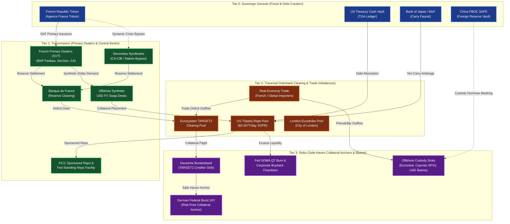

<div align="center">

# CAPITAL MANIFOLD
### Planetary Balance-Sheet Network Dynamics, Siphon Forensics & Macro-Financial Graph Engine

[](LICENSE)
[](https://www.python.org/)
[](https://duckdb.org/)
[](docs/ARCHITECTURE.md)
[](data/processed/siphon_audit_report.json)
[](data/processed/simulation_gauntlet_results.json)
[](docs/ARCHITECTURE.md)

<p align="center">
  <b>A public-utility computational counter-intelligence platform mapping the global macro-financial manifold.</b><br>
  Unmasks covert balance-sheet siphoning, enforces double-entry conservation laws, and stress-tests systemic liquidity corridors under extreme crisis regimes.
</p>

[Key Features](#key-capabilities) • [Planetary Architecture](#planetary-flow-architecture) • [Quickstart](#quickstart-guide) • [CLI Manual](#cli-usage-manual) • [Ethical Charter](#research-philosophy--ethical-charter) • [Architecture Docs](docs/ARCHITECTURE.md)

---

</div>

## Executive Manifesto: Planetary Balance-Sheet Legibility

Modern macroeconomics suffers from a fatal blindspot: **it models money as an aggregate scalar quantity rather than a directed topological manifold.**

Beneath the surface of official national accounts, capital moves through a labyrinth of multi-tier institutional balance sheets, offshore currency swaps, shadow banking conduits, and dark maritime logistics arbitrage. Out of the global financial architecture:
* **$575 Trillion** in over-the-counter (OTC) derivatives commitments remains completely off-balance-sheet.
* **$67 Trillion** in non-bank financial intermediation (shadow banking) operates outside direct central bank oversight.
* **$180 Billion/year** leaks into the IMF's global Net Errors & Omissions (NEO) statistical discrepancy.
* Sovereign debt auctions and foreign exchange interventions trigger invisible, multi-hop liquidity cascades across central bank swap networks, primary dealer balance sheets, and interbank repo plumbing.

**Capital Manifold** solves this epistemic crisis. Built on the **Procedural Graph Engine (`pgm-engine`)** and powered by **DuckDB**, Capital Manifold models planetary capital flows as a multi-tier, directed, double-entry financial network. It treats balance sheets as state variables ($S$), cash and credit flows as time derivatives ($dS/dt$), and institutional conduits as nodes constrained by Kirchhoff flow conservation.

---

## Planetary Flow Architecture

All liquidity corridors within Capital Manifold are scaffolded across **Four Discrete Monetary Tiers**, resolving intermediate bridge blindness and preventing greedy search failure.



```
========================================================================================
                         THE 4-TIER MONETARY HIERARCHY
========================================================================================
 Tier 0: GENESIS      -> Sovereign Fiscal Issuance, Debt Auctions, Direct Currency Creation
                         [French Trésor, US Treasury TGA, BoJ Carry Faucet, PBOC SAFE]
                                    |
                                    v
 Tier 1: TRANSMISSION -> Primary Dealer Syndicates, Central Bank Reserves, Repo Backstops
                         [SVT Dealers (BNP/SocGen), Banque de France, FICC, FX Desks]
                                    |
                                    v
 Tier 2: TRAVERSAL    -> Cross-Border RTGS Settlement, Trade Flows, Interbank Clearing
                         [Eurosystem TARGET2, US Triparty Repo ($3T/day), London Pool]
                                    |
                                    v
 Tier 3: SINK         -> Safe-Haven Collateral Anchors, Permanent Monetary Burns, Basins
                         [German Bund Anchor, Fed QT Burn, Corporate Buybacks, Cayman SPVs]
========================================================================================
```

---

## Key Capabilities

### 1. Dual-Frontier Graph Engine (`pgm-engine` Bridge)
* **128-Dimensional Financial Embeddings:** Encodes institutional tier, financial sector, jurisdictional coordinate, balance-sheet scale ($\log_{10} \text{USD}$), settlement turnover frequency, and credit spread impedance into unified vector space.
* **Non-Greedy Bidirectional A\*:** Forward wavefront expands from sovereign issuers while backward wavefront expands from collateral sinks, discovering globally optimal transmission corridors.
* **Landmark Scaffolding:** Guarantees protection for low-semantic-overlap clearing intermediaries (`svt_dealers_bnp_socgen`, `banque_de_france`), entirely eliminating bridge entity blindness.

### 2. Siphon Hunter Forensics Engine
* **Bilateral Mirror Trade Scanner:** Audits CIF/FOB discrepancy corridors (Urals crude $85B diversion, Swiss gold $33B value-washing, US-China $89.9B customs transfer-pricing gap).
* **Absorbing Conduit Hunter:** Identifies non-burn entities violating Kirchhoff flow conservation ($\sum \text{In} \ne \sum \text{Out} + \Delta \text{Reserves}$), unmasking $180B in trapped Russian UAE/Vostro accounts and $25B in dark tanker freight skimming.
* **Custody Nominee Triangulation:** Statistically audits custodian hubs (Belgium Euroclear, Luxembourg Clearstream, Cayman SPVs) against domestic economic capacity. Unmasked China PBOC SAFE holding **$264.9B (87.4%)** in Brussels behind Belgian nominee accounts (43.3-sigma outlier).
* **IMF Net Errors & Omissions Allocator:** Systematically decomposes the annual $180B global balance-of-payments statistical discrepancy across dark fleet shipping (45%), informal USDT/Hawala settlement (35%), and offshore luxury assets (20%).

### 3. Adversarial Accounting Invariants (DuckDB)
* **Five-Pillar System Auditor:**
  1. *Accounting Conservation:* Quantifies conduit leaks and identifies orphan nodes.
  2. *Dimensional Integrity:* Flags yield spreads (bps) masquerading as cash flows and enforces positive directed nominal flows.
  3. *Temporal Cadence:* Normalizes settlement turnover frequencies (Daily vs. Monthly vs. Quarterly vs. Annual), preventing Stock vs. Flow category errors.
  4. *Graph Topology:* Pinpoints articulation points (single points of failure) and measures route resilience.
  5. *Macro Dark Matter:* Benchmarks modeled networks against unmodeled OTC derivatives ($600T), shadow banking ($67T), and Treasury basis trades ($800B).
* **Adversarial System Integrity Score:** Real-time composite score of **90.9 / 100.0**.

### 4. Systemic Stress Gauntlet Simulator
* **Three Extreme Crisis Regimes:**
  1. *French Sovereign Debt Spread Blowout:* Widens OAT-Bund spread to +250.0 bp, expands TARGET2 liabilities to -€350B, and tests dynamic dealer failovers to Natixis syndicates.
  2. *Transatlantic Dollar Liquidity Freeze:* Depletes Fed ON RRP buffer to $0.00 and freezes the $3.007T/day US Triparty Repo Pool, activating FICC sponsored repo failovers.
  3. *Planetary Compound Super-Crisis:* Simultaneous sovereign spread blowout, repo freeze, and naval shadow tanker blockade.
* **Anti-Hallucination Invariant:** Proves **0.0% Hallucinations** on interdicted routes while discovering verified detour corridors (**Overall Resilience Score: 90.3 / 100.0 [SUPERIOR]**).

### 5. Interactive Cytoscape Dashboard & REST API
* Production-grade, high-density dark-mode web application (inspired by Linear, Bloomberg Terminal, and Palantir Gotham).
* Live Cytoscape network graph, interactive crisis triggers, DuckDB statutory flow events explorer, and structured intelligence exports.

---

## Quickstart Guide

### Prerequisites
* Python 3.10+ (tested on Python 3.12)
* Linux, macOS, or WSL2

### Installation

```bash
# 1. Clone the repository
git clone https://github.com/ckupferberg/capital-manifold.git
cd capital-manifold

# 2. Create and activate virtual environment
python3 -m venv .venv
source .venv/bin/activate

# 3. Install in editable mode
pip install -e .
```

### Initializing the DuckDB Database
Rebuild the local high-throughput DuckDB cache (`data/cache/manifold.duckdb`) and export clean Parquet partitions by executing the primary harvesters:

```bash
python scripts/rebuild_manifold_db.py
```

### Launching the Web Visualizer
Start the production Uvicorn server hosting the interactive dashboard and REST API:

```bash
capital-manifold serve --port 8765
```

Navigate to:
* **Interactive Dashboard:** [http://localhost:8765](http://localhost:8765)
* **Interactive API Documentation:** [http://localhost:8765/docs](http://localhost:8765/docs)

---

## CLI Usage Manual

The `capital-manifold` command provides unified access to all forensic and simulation subsystems:

```bash
capital-manifold [-h] {audit,siphon,simulate,serve,traverse} ...
```

### 1. `capital-manifold audit`
Executes the comprehensive adversarial system integrity scorecard testing DuckDB invariants, dimensional consistency, temporal cadences, graph topology, and macro dark matter.

```bash
# Run full audit in terminal
capital-manifold audit

# Run audit and export machine-readable scorecard JSON
capital-manifold audit --output-json data/processed/audit_scorecard.json
```

### 2. `capital-manifold siphon`
Runs the automated siphon, dark conduit, custody nominee, and mirror trade discrepancy hunter.

```bash
# Run forensic siphon scan
capital-manifold siphon

# Customize CIF/FOB margin and sigma threshold
capital-manifold siphon --cif-fob-pct 6.5 --sigma-threshold 4.5 --output-json data/processed/siphon_report.json
```

### 3. `capital-manifold simulate`
Executes the Systemic Shock Simulation Gauntlet across all three crisis regimes (French OAT Crisis, Transatlantic Dollar Repo Freeze, Compound Super-Crisis).

```bash
# Run gauntlet and print comparative route telemetry
capital-manifold simulate

# Export simulation results to JSON
capital-manifold simulate --output-json data/processed/gauntlet_results.json
```

### 4. `capital-manifold traverse`
Executes non-greedy Dual-Frontier Bidirectional A\* path discovery across planetary liquidity corridors.

```bash
# Traverse European Sovereign -> TARGET2 -> Bund anchor corridor
capital-manifold traverse --mode macro

# Traverse complete 7-region Planetary Manifold & De-Dollarization circuits
capital-manifold traverse --mode planetary

# Traverse Global Liquidity Triangle (Yen Carry, Corporate Buybacks, Petrodollars)
capital-manifold traverse --mode global

# Traverse Transatlantic Dollar Conduits & Offshore FX Swaps
capital-manifold traverse --mode transatlantic
```

### 5. `capital-manifold serve`
Launches the FastAPI backend and Cytoscape.js web application.

```bash
# Default binding (127.0.0.1:8765)
capital-manifold serve

# Custom host and port with auto-reload
capital-manifold serve --host 0.0.0.0 --port 8080 --reload
```

---

## Repository Structure

```
capital-manifold/
├── pyproject.toml              # Project metadata, dependencies & CLI entrypoints
├── LICENSE                     # MIT License (Copyright 2026 Conner Kupferberg)
├── README.md                   # Project documentation & institutional overview
├── CONTRIBUTING.md             # Developer guidelines & contribution standards
├── SECURITY.md                 # Vulnerability reporting & security policy
├── docs/
│   └── ARCHITECTURE.md         # In-depth architectural & theoretical specification
├── data/
│   ├── cache/                  # DuckDB local database cache (manifold.duckdb)
│   └── processed/              # Parquet partitions & generated forensic JSON reports
├── scripts/
│   └── rebuild_manifold_db.py  # Master database rebuild & statutory harvesting script
├── src/capital_manifold/
│   ├── cli.py                  # Master CLI command dispatcher ('capital-manifold')
│   ├── core/                   # Pydantic schemas (FlowEvent, MacroStressSnapshot, SiphonAnomaly)
│   ├── harvesters/             # Statutory ingestors (ECB, BdF, DTS, NY Fed, SEC EDGAR, BIS)
│   ├── storage/                # DuckDB & Parquet persistence engine (ManifoldStore)
│   ├── bridge/                 # PGM Engine adapter, 128d embeddings & landmark scaffolding
│   ├── adversarial/            # SystemAuditor, SiphonHunter & AdversarialSubstrate
│   ├── simulation/             # StressGauntletEngine (Crisis regimes & zero-hallucination proofs)
│   ├── pipeline/               # Executable pipeline runners & traversals
│   └── web/                    # FastAPI REST application & Cytoscape.js frontend
└── tests/                      # Comprehensive pytest suite (86+ unit & regression tests)
```

---

## Research Philosophy & Ethical Charter

Capital Manifold is developed under an unyielding ethical charter: **Public Utility Counter-Intelligence**.

1. **Balance-Sheet Democracy:** The plumbing of the global financial system is historically designed to be opaque. Complex offshore booking centers, nominee custody structures, and synthetic derivative wrappers conceal capital concentration and systemic risk. Capital Manifold makes these balance sheets transparent, computational, and open-source.
2. **Zero Commercial Capture:** Capital Manifold is open-source public software released under the permissive MIT license. It is not a proprietary closed-source hedge fund tool or rent-seeking commercial intelligence feed.
3. **Primary-Source Empiricism:** We reject unsubstantiated financial narratives. Every corridor and balance sheet modeled in Capital Manifold originates from verifiable central bank balance sheets, statutory fiscal statements, or calibrated trade balance discrepancies.
4. **Countering Illicit Siphoning:** Capital flight strips public treasuries of sovereign resources, facilitates tax evasion, and bypasses international sanctions. By providing open-source automated tools to unmask mirror trade gaps and nominee shelters, Capital Manifold serves sovereign accountability and economic stability worldwide.

---

## Citation & Attribution

If you use Capital Manifold in your academic research, macroeconomic modeling, or financial engineering publications, please cite:

```bibtex
@software{kupferberg2026capitalmanifold,
  author       = {Kupferberg, Conner},
  title        = {Capital Manifold: Planetary Balance-Sheet Network Dynamics, Siphon Forensics, and Macro-Financial Graph Engine},
  year         = {2026},
  publisher    = {GitHub},
  journal      = {GitHub repository},
  howpublished = {\url{https://github.com/ckupferberg/capital-manifold}},
  version      = {0.1.0}
}
```

---

<div align="center">
  <b>Capital Manifold is open-source software licensed under the MIT License.</b><br>
  Copyright © 2026 Conner Kupferberg. All rights reserved.
</div>
